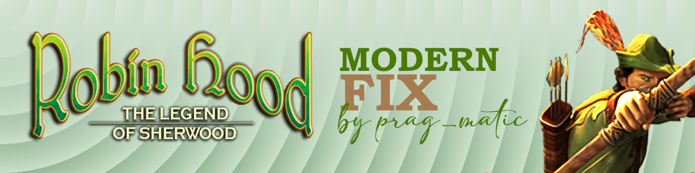
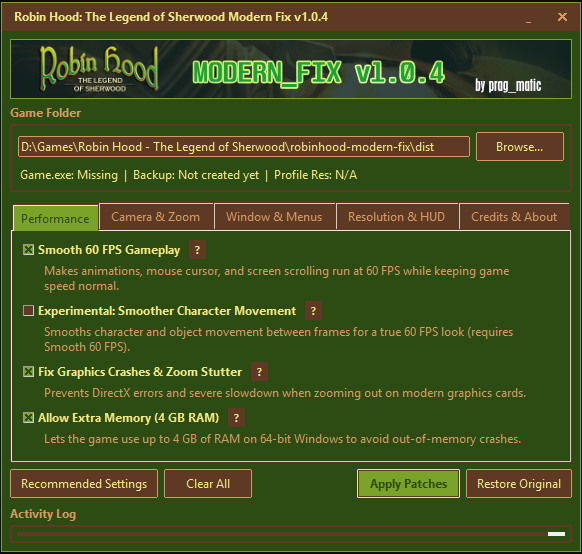
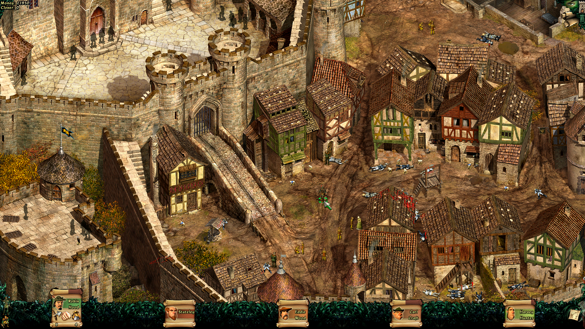
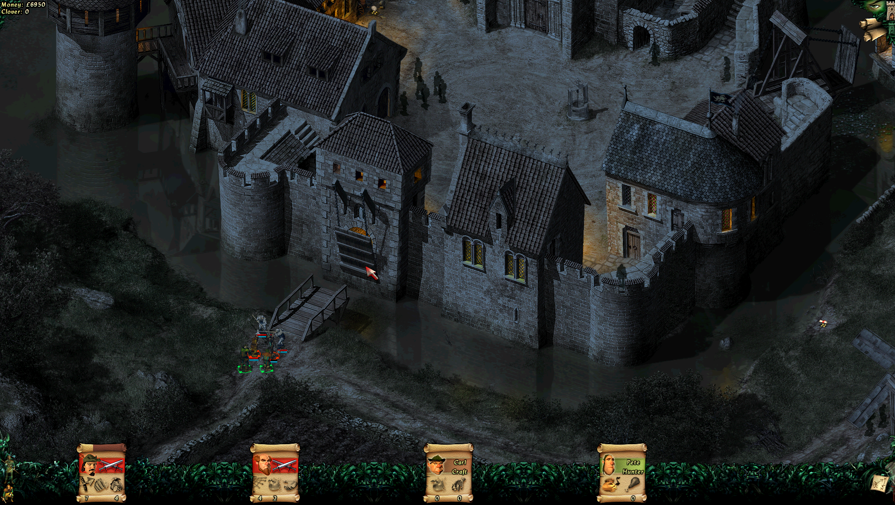

<div align="center">



# Robin Hood: The Legend of Sherwood — Modern Fix

**Play the classic tactical stealth game smoothly at 60 FPS in Widescreen (1080p / 1440p / Ultrawide) on modern Windows 10 & 11 PCs.**

[](https://github.com/prag-matic/robinhood-modern-fix/releases)
[](https://github.com/prag-matic/robinhood-modern-fix)
[](https://github.com/prag-matic/robinhood-modern-fix)

</div>

---

## What It Fixes

- **Smooth 60 FPS Gameplay**: Animations, mouse cursor, and screen scrolling run at a fluid 60 FPS while keeping combat, patrols, and game timers at their original speed.
- **Widescreen & Extended HUD**: Play in `1920x1080`, `2560x1440`, ultrawide, or any custom resolution—with the bottom HUD foliage automatically extended so there are no empty gaps on the sides.
- **No More Zoom Lag or Black Ground**: Fixes the severe frame-rate drops and missing black ground textures when zooming out on modern graphics cards.
- **Smooth Camera Scrolling**: Eliminates jerky camera movement and lets you customize your scroll speed (or disable camera glide).
- **Effortless Alt-Tab & Borderless Fullscreen**: Switch between windows freely without the game forcing itself on top, trapping your cursor, or causing monitor "No Signal" issues on 120 Hz+ displays.
- **Modern In-Game Options Menu**: Updates the old 4:3 resolution buttons in the game's Options screen to `1280x720`, `1920x1080`, and `2560x1440` (or your custom size).
- **Experimental Smoother Character Motion**: Optional 60 FPS character movement smoothing for an even cleaner look.
- **100% Toggleable & Reversible**: Pick and choose any fix in the graphical patcher, and restore your original game files anytime with one click.

---

## Screenshots

### Patcher GUI

<p align="center">
  
</p>

### In-Game

| | |
| :---: | :---: |
|  |  |

---

## Quick Start (Installation)

1. Download **`RobinHood_ModernFix.zip`** from the [Releases](https://github.com/prag-matic/robinhood-modern-fix/releases) page.
2. Open your *Robin Hood: The Legend of Sherwood* installation folder (where `Game.exe` is located) and back up the original `ddraw.dll` (e.g., rename it to `ddraw.dll.gog.bak`).
3. Extract all files from `RobinHood_ModernFix.zip` into the game folder next to `Game.exe` (overwrite `ddraw.dll` when asked).
4. Double-click **`RobinHood_ModernFix.exe`** to open the patcher, pick your screen resolution, and click **Apply Patches**.
5. Launch the game normally!

> **Note:** Backups (`Game.exe.bak`, `Profiles.bak`, `DEFAULT.RES.bak`) are created automatically before anything is changed. Click **Restore Original** in the patcher at any time to revert.

---

## Technical Details & CLI

<details>
<summary><strong>Supported Game Version & Verification</strong></summary>

- **Target Binary**: *Robin Hood: The Legend of Sherwood* **GOG 1.1.0.0**
- **Original `Game.exe` SHA-256**: `b0963242470d96cdd8021e2cb81ccbc5e26b4fb2cb122febdec50ad30774f08e`
- The patcher always reads from `Game.exe.bak` and verifies this SHA-256 hash before applying any binary patches.

</details>

<details>
<summary><strong>Under the Hood: Binary, Config & Asset Patches</strong></summary>

- **60 FPS Render Loop & 1 ms Frame Pacing**: Unlocks the render/input/camera loop to ~60 FPS using `timeGetTime`, `timeBeginPeriod(1)`, and `Sleep(1)` in a `.fix` code cave (`0x006c7134`), while gating `FUN_004c6ef0` (simulation tick) to 25 Hz (`40 ms`).
- **Experimental 60 FPS Entity `(x, y)` Interpolation (`--interp`)**: Hooks simulation tick (`0x006c7245`) and world draw (`0x006c738c`) to interpolate entity draw coordinates between 25 Hz ticks.
- **DirectDraw `DDSCAPS_SYSTEMMEMORY` Fix**: Replaces `VIDEOMEMORY` offscreen surface flags with `SYSTEMMEMORY` (`0x0840`) at `0x005e2876` and `0x005e28a6` to eliminate GPU↔CPU `Lock()` readback stalls and `DDERR_GENERIC` errors.
- **Smooth Camera Panning**: Removes stepped `+1.0` pan jitter (`0x005121f8`), sets a smooth exponential pan curve (`2.5` default base speed at `0x005121c9` with 60 FPS coasting), and optionally disables ramp-up/coasting (`--linear-pan`).
- **Large Address Aware (LAA)**: Sets `IMAGE_FILE_LARGE_ADDRESS_AWARE` (`0x0020`) in `Game.exe`'s PE header for 4 GB virtual memory on 64-bit Windows.
- **Widescreen Zoom & Black-Texture Hotfix**: Clips out-of-bounds DirectDraw `Blt` source rectangles (`DDERR_INVALIDRECT`) via `0x005e1e9e` / `0x00676f20` and adjusts initial zoom on narrow maps via `0x00510c55` / `0x00676f90`.
- **Borderless / Alt-Tab Focus Fix**: Clears `WS_EX_TOPMOST` (`0x005e3e4e`) and gates `SetCursorPos` (`0x0050f98e`) to foreground window focus (`0x006c7024`).
- **In-Game Options Resolution Buttons**: Repurposes the 3 Options screen resolution handlers (`0x0052cfa9..0x0052d0c4`) and UTF-16 `std::wstring` labels (`0x0052cb77` -> `0x006c7094`) to `1280x720`, `1920x1080`, and `2560x1440` (or custom `WxH`).
- **Profile & HUD Foliage Patching**: Writes `float32` width/height to `DATA\Savegame\Profiles` (offset `0x104`) and extends mirrored RGB565 foliage strips in `DATA\Interface\DEFAULT.RES` for widths `> 1024 px`.
- **DDrawCompat 60 Hz Preset (`DDrawCompat.ini`)**: Configured with `FullscreenMode = borderless` for tear-free 60 Hz VSync.

</details>

<details>
<summary><strong>Command-Line Interface (CLI) Options</strong></summary>

Running `RobinHood_ModernFix.exe` with no arguments opens the GUI. Passing any flag runs headlessly:

```powershell
RobinHood_ModernFix.exe --cli                  # Apply all recommended defaults headlessly
RobinHood_ModernFix.exe --gui                  # Force-launch the graphical UI
RobinHood_ModernFix.exe --res 2560x1440        # Set custom resolution (default: 1920x1080)
RobinHood_ModernFix.exe --no-res               # Skip resolution & HUD foliage patching
RobinHood_ModernFix.exe --pan-speed 2.5        # Custom base camera pan speed
RobinHood_ModernFix.exe --linear-pan           # Instant linear pan (no ramp/coasting)
RobinHood_ModernFix.exe --interp               # Experimental 60 FPS entity (x, y) interpolation
RobinHood_ModernFix.exe --no-fps               # Skip 60 FPS unlock & 1 ms Sleep(1) pacing
RobinHood_ModernFix.exe --no-sysmem            # Keep original VIDEOMEMORY surface flags
RobinHood_ModernFix.exe --no-pan               # Skip smooth camera panning patch
RobinHood_ModernFix.exe --no-laa               # Skip Large Address Aware (4 GB) PE flag
RobinHood_ModernFix.exe --no-zoom              # Skip zoom & viewport bounds fix
RobinHood_ModernFix.exe --no-window            # Skip borderless / Alt-Tab focus fix
RobinHood_ModernFix.exe --no-options-buttons   # Keep original Options resolution buttons
RobinHood_ModernFix.exe --revert               # Restore Game.exe, Profiles, and DEFAULT.RES
```

</details>

<details>
<summary><strong>Building the Executable Locally</strong></summary>

```powershell
pip install pyinstaller
pyinstaller --onefile --add-data "assets/banner.png;assets" --name RobinHood_ModernFix robinhood_modern_fix.py
```

</details>

---

## Credits

- **[prag-matic](https://github.com/prag-matic)** — Reverse engineering, binary patches, widescreen HUD extension, and Modern Fix GUI/CLI.
- **[narzoul](https://github.com/narzoul/DDrawCompat)** — [DDrawCompat](https://github.com/narzoul/DDrawCompat) v0.7.2, providing borderless 60 Hz DirectDraw compatibility on modern Windows.
- **Spellbound Entertainment / GOG** — *Robin Hood: The Legend of Sherwood*.

---

## Legal Disclaimer

- This project is an **unofficial community patch** and is not affiliated with, endorsed by, or associated with **Spellbound Entertainment**, **THQ Nordic**, **Microids**, or **GOG**.
- **No copyrighted game files or assets are included** in this repository or release packages. You must own a legitimate copy of *Robin Hood: The Legend of Sherwood* (GOG 1.1.0.0) to use this patcher.
- All trademarks, game titles, and logos belong to their respective owners.
- This software is provided **"as is"**, without warranty of any kind. Use at your own risk (automatic backups of `Game.exe`, `Profiles`, and `DEFAULT.RES` are created prior to patching).
